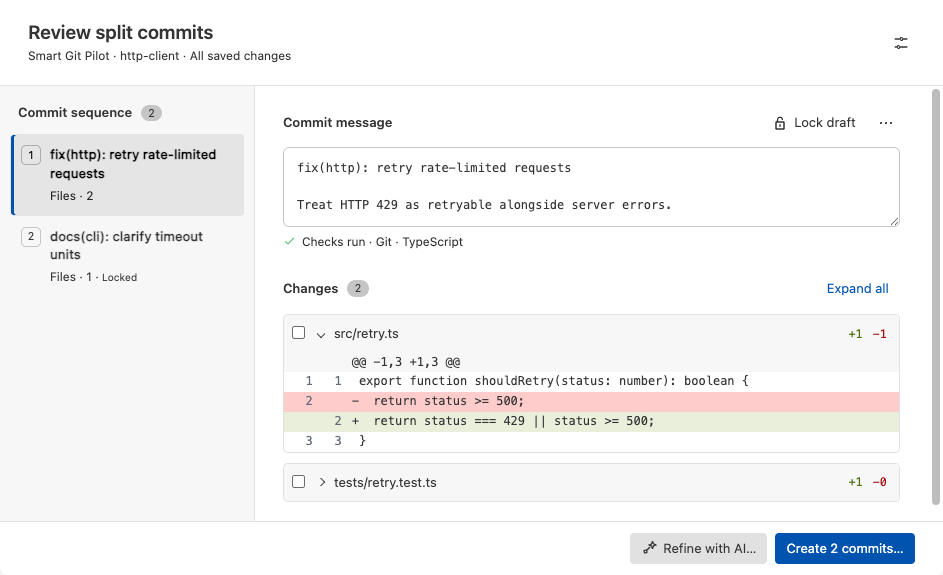

# Smart Git Pilot

Smart Git Pilot extends VS Code’s Source Control view and editor. Browse the history behind a line of code, set work aside while you switch branches, and use your own AI model to prepare commits for review.

[Visual Studio Marketplace](https://marketplace.visualstudio.com/items?itemName=michael-yu.smart-commit-pilot) · [Open VSX](https://open-vsx.org/extension/michael-yu/smart-commit-pilot) · [简体中文](README.zh-CN.md)

## Features

| Feature | What you can do |
| --- | --- |
| Branches and history | Browse local branches, remotes, tags, and contributors. Expand a commit to see which files changed and inspect their diffs. |
| Line blame | See who last changed the line under your cursor and when. Hover to read the commit message or copy its hash. |
| Commit messages | Generate an editable message from the staged diff in your team’s language and format. |
| Commit splitting | Group changes by purpose, down to individual text edits within a file. Review each draft’s diff and message before committing. |
| Stashes | Save work from the repository toolbar. Restore a stash and choose whether to keep the entry. |

## Get started

1. Install **Smart Git Pilot** and open a Git repository in VS Code.
2. Open **Source Control → Smart Git Pilot** to explore the repository. The toolbar above the commit input holds the message, split, and stash actions. Branch browsing, line blame, stashes, and manual grouping work without AI setup.
3. To use AI, run **Smart Git Pilot: Setup Provider** from the Command Palette. Choose OpenAI or Anthropic, enter your endpoint and API key, and select a commit message model. The first AI split prompts for its own model. For a compatible endpoint, select the provider whose API it implements.

## Explore a repository

Use the icons in the **Smart Git Pilot** view to switch between branches, remotes, tags, and contributors. Select **View as Tree** to group branches with shared name prefixes. From a branch row you can switch, fetch, or create a branch. The local branch context menu also offers deletion and lets you choose whether to delete the corresponding remote branch.

To find when a change landed, expand a branch or tag, then a commit, and select a file to see what changed since that commit’s first parent. If you already have the file open, place the cursor on the line and hover over its author annotation.

## Prepare commits

### Write a message for staged changes

Stage the changes for one commit and select **Generate Commit Message**. The message appears in the Source Control input, ready to edit. The default is Conventional Commits. Use **Smart Git Pilot: Setup Prompt** for team conventions such as “Use a one-line subject and list the main changes as bullets.” Split drafts follow the same instructions for their messages.

### Split a set of mixed changes

A retry fix, its regression test, and an unrelated documentation edit can all be in the same working tree. Open **Split Changes into Commits…**, choose **Staged changes** or **All saved changes**, and give a grouping instruction such as “Keep the retry fix and test together. Put the CLI docs in a separate commit.” All saved changes includes saved edits, deletions, and new files Git can track.

- **Plan.** Automatic mode groups small changes in one round and analyzes, groups, and orders complex changes over multiple rounds. Choose **Group manually** to build the drafts locally.
- **Review.** Read each diff, edit the message, and drag drafts to reorder them. Use **Select part of this file** and **Move selected changes…** to move a block or individual edit to another draft.
- **Refine.** **Lock draft** preserves its diff and message. Choose **Refine with AI…** to regroup the unlocked drafts, or use a single draft’s actions to split it further or rewrite its message.
- **Commit.** The preview shows per-commit Git checks and, where applicable, manifest and TypeScript diagnostics. Confirm the ordered list to create the commits with your hooks and configured signing. A changed branch or snapshot requires a fresh preview.

Open the splitter with `Ctrl+K Ctrl+Shift+G` on Windows and Linux, or `⌘K ⇧⌘G` on macOS.

## Stash and restore work

Open the **down-arrow tray** beside the split button in the repository you want to act on.

| Action | Effect |
| --- | --- |
| Stash | Save changes to tracked files. Choose **Stash (Include Untracked)** to include new files or **Stash Staged** for staged changes only (Git 2.35+). |
| Apply / Pop | Both restore the selected stash. **Apply** keeps the entry. **Pop** removes it after a successful restore. |
| Drop | Confirm to delete the selected entry. |

## Configuration and data

| Setting | Purpose |
| --- | --- |
| `smartCommitPilot.provider`, `smartCommitPilot.baseUrl` | Provider and endpoint shared by both AI workflows. The API key is stored in VS Code SecretStorage. |
| `smartCommitPilot.model` | Model for commit messages. Change it with **Select Commit Message Model**. |
| `smartCommitPilot.composer.model` | Model for splitting and refining drafts. Change it in **Draft settings → Split model**. |
| `smartCommitPilot.prompt` | Commit message format, language, and writing conventions. |
| `smartCommitPilot.blame.enabled`, `smartCommitPilot.blame.avatars` | Current-line annotations and author avatars. Avatars can load from GitHub or Gravatar. |

AI actions send the selected changes and relevant instructions to your configured endpoint. Multi-round planning requests reuse of the diff prefix where supported. One-off commit messages request that supported OpenAI models skip cache writes. Provider-reported usage appears in **Output → Smart Git Pilot**.

Requires VS Code 1.85+ with its built-in Git extension enabled. Branch operations require Git 2.23+. The interface supports English, Simplified Chinese, and Traditional Chinese.

[Release notes](CHANGELOG.md) · [Report an issue](https://github.com/lixinqiany/smart-commit-pilot/issues) · [MIT license](LICENSE)
