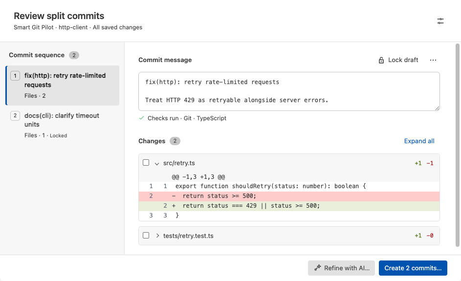

# Smart Git Pilot

Smart Git Pilot 为 VS Code 的源代码管理视图和编辑器增加了常用 Git 工具。你可以从一行代码找到上次修改它的提交，切换分支前收起手头的改动，也可以用自己的 AI 模型整理改动、准备提交。

[Visual Studio Marketplace](https://marketplace.visualstudio.com/items?itemName=michael-yu.smart-commit-pilot) · [Open VSX](https://open-vsx.org/extension/michael-yu/smart-commit-pilot) · [English](README.md)

## 主要功能

| 功能 | 可以做什么 |
| --- | --- |
| 分支与提交历史 | 按本地分支、远端仓库、标签或贡献者浏览提交。展开一笔提交，即可查看改了哪些文件以及具体差异。 |
| 当前行注释 | 在光标所在行查看最后修改者和修改时间。悬停可读提交信息、复制提交哈希。 |
| 生成提交信息 | 根据已暂存的差异起草提交信息，直接写入提交输入框，支持团队约定的语言和格式。 |
| 拆分提交 | 将混合改动按目的分组，细到同一文件中的单项文本改动。逐笔审阅差异和提交信息，确认后再提交。 |
| 储藏与恢复 | 从仓库工具栏收起手头的改动。恢复时可以选择保留储藏记录，方便再次使用。 |

## 快速开始

1. 安装 **Smart Git Pilot**，在 VS Code 中打开一个 Git 仓库。
2. 打开 **源代码管理 → Smart Git Pilot** 浏览仓库。提交输入框上方是生成提交信息、拆分和储藏的入口。分支浏览、当前行注释、储藏和手动分组都可以直接使用。
3. 需要 AI 时，在命令面板运行 **Smart Git Pilot: 配置服务提供商**。选择 OpenAI 或 Anthropic，填写端点地址和 API Key，选定生成提交信息的模型。首次用 AI 拆分时，再单独选择拆分模型。使用自定义端点时，请选择与其协议匹配的服务商。

## 浏览仓库

在 **Smart Git Pilot** 视图顶部切换本地分支、远端仓库、标签和贡献者。选择 **以树形显示**，可将名称前缀相同的分支归在一起。在分支行上可以切换分支、抓取更新，或从此处创建新分支。右键删除本地分支时，可以选择是否一并删除对应的远程分支。

想知道某次提交具体改了什么，可以依次展开分支或标签、提交，再点文件，查看这笔提交相对其第一个父提交改了哪些内容。已经在编辑器里读代码时，把光标放在关心的那一行，悬停查看行尾的作者注释即可。

## 准备提交

### 为已暂存改动生成提交信息

暂存准备放进同一笔提交的改动，点击 **生成提交信息**。生成的文字会出现在源代码管理的提交输入框，可以直接编辑。默认格式是 Conventional Commits。通过 **Smart Git Pilot: 配置提示词** 可以指定团队习惯，例如「标题用一行概括，正文用项目符号列出主要改动」。拆分草稿时也会沿用这些写作要求。

### 把混合改动拆成多笔提交

比如你修复了请求重试逻辑，补了回归测试，又顺手改了一处命令行文档。打开 **拆分改动为多个提交…**，选择 **已暂存改动** 或 **全部已保存的改动**，再告诉 AI「重试修复和测试放在一起，命令行文档单独提交」。选择全部已保存的改动时，会纳入已保存的编辑、删除和 Git 可跟踪的新文件。

- **生成草稿。** 自动模式对简单改动做一轮分组，对复杂改动分轮分析、分组和排序。选 **手动分组** 也可以在本地整理。
- **逐笔审阅。** 查看差异、编辑提交信息，拖动草稿可调整顺序。展开文件，点 **选择部分改动**，再用 **移动所选改动…** 把改动块或单项编辑移到另一笔草稿。
- **继续调整。** **锁定草稿** 会保留它的差异和提交信息。选择 **让 AI 继续调整…** 可重新整理未锁定的草稿。只想拆细某一笔或重写它的提交信息时，打开这笔草稿的 **更多操作**。
- **确认提交。** 预览列出每笔提交对应的 Git 检查结果，适用时也会检查清单语法和 TypeScript 诊断。确认提交顺序后，Git 会运行提交钩子并按配置签名。如果分支或所选改动已经变化，插件会提示重新生成预览。

拆分面板的快捷键是 Windows/Linux 的 `Ctrl+K Ctrl+Shift+G`，macOS 的 `⌘K ⇧⌘G`。

## 储藏与恢复改动

点击目标仓库提交框上方的 **向下箭头托盘图标**，即可操作该仓库的储藏记录。

| 操作 | 效果 |
| --- | --- |
| 储藏 | **储藏** 收起已跟踪文件的改动。**储藏(包含未跟踪)** 会一并收起新文件。**储藏暂存** 只收起已暂存改动，需要 Git 2.35+。 |
| 应用 / 弹出 | 两者都能恢复所选改动。**应用储藏**（Apply）保留记录，**弹出储藏**（Pop）在恢复成功后移除记录。 |
| 删除 | **删除储藏**（Drop）在确认后删除所选记录。 |

## 配置与数据

| 设置 | 用途 |
| --- | --- |
| `smartCommitPilot.provider`、`smartCommitPilot.baseUrl` | 两个 AI 功能共用的服务商和端点。API Key 保存在 VS Code SecretStorage 中。 |
| `smartCommitPilot.model` | 生成提交信息的模型，通过 **选择提交信息模型** 更改。 |
| `smartCommitPilot.composer.model` | 拆分和调整草稿的模型，通过 **草稿设置 → 拆分模型** 更改。 |
| `smartCommitPilot.prompt` | 提交信息的格式、语言和写作要求。 |
| `smartCommitPilot.blame.enabled`、`smartCommitPilot.blame.avatars` | 分别控制当前行注释和作者头像。头像可能从 GitHub 或 Gravatar 加载。 |

使用 AI 时，插件会把所选改动和相关指令发送到配置的端点。多轮拆分会在支持的模型上请求复用差异内容的缓存。生成单笔提交信息时，插件会在支持的 OpenAI 模型上请求跳过缓存写入。服务商返回的用量可在 **输出 → Smart Git Pilot** 中查看。

需要 VS Code 1.85+ 并启用内置 Git 扩展。分支操作需要 Git 2.23+。界面支持英文、简体中文和繁体中文。

[更新日志](CHANGELOG.md) · [反馈问题](https://github.com/lixinqiany/smart-commit-pilot/issues) · [MIT 许可证](LICENSE)
